<p align="center">
  <a href="https://vibefield.github.io/strata-ecs/">
    <picture>
      <source media="(prefers-color-scheme: dark)" srcset=".github/readme/hero-dark.svg">
      
    </picture>
  </a>
</p>

<p align="center">
  <b>An entity-component-system for apps that edit documents.</b><br>
  Whiteboards, node graphs, design tools. Fast as typed arrays, reactive,<br>
  and multiplayer when you want it, as a layer you add and not a rewrite.
</p>

<p align="center">
  <a href="https://vibefield.github.io/strata-ecs/"><b>Guide</b></a>&nbsp;&nbsp;·&nbsp;
  <a href="https://vibefield.github.io/strata-ecs/api.html">API</a>&nbsp;&nbsp;·&nbsp;
  <a href="https://vibefield.github.io/strata-ecs/demo/">Live demo</a>&nbsp;&nbsp;·&nbsp;
  <a href="BENCHMARKS.md">Benchmarks</a>&nbsp;&nbsp;·&nbsp;
  <a href="https://www.npmjs.com/package/@vibecook/strata-ecs">npm</a>&nbsp;&nbsp;·&nbsp;
  <a href="CHANGELOG.md">Changelog</a>
</p>

<p align="center">
  <a href="https://github.com/vibefield/strata-ecs/actions/workflows/ci.yml"><picture><source media="(prefers-color-scheme: dark)" srcset="https://img.shields.io/github/actions/workflow/status/vibefield/strata-ecs/ci.yml?branch=main&label=ci&style=flat-square&labelColor=212437&color=e6eafb"></picture></a>
  <a href="https://www.npmjs.com/package/@vibecook/strata-ecs"><picture><source media="(prefers-color-scheme: dark)" srcset="https://img.shields.io/npm/v/%40vibecook%2Fstrata-ecs?label=npm&style=flat-square&labelColor=212437&color=e6eafb"></picture></a>
  <a href="LICENSE"><picture><source media="(prefers-color-scheme: dark)" srcset="https://img.shields.io/badge/license-MIT-e6eafb?style=flat-square&labelColor=212437"></picture></a>
</p>

<br>

<p align="center">
  <a href="https://vibefield.github.io/strata-ecs/demo/">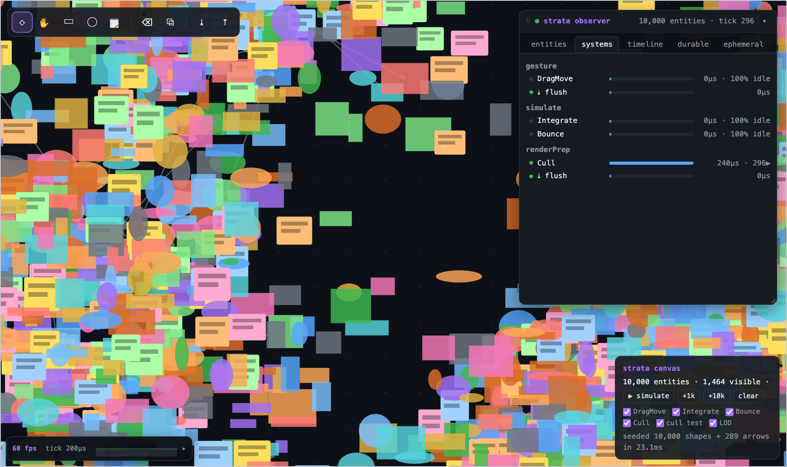</a>
</p>

<p align="center"><sub>The example whiteboard holding 10,000 shapes, with the observer from <code>@vibecook/strata-ecs/tools</code>. A screenshot of the <a href="https://vibefield.github.io/strata-ecs/demo/">live demo</a>, not a mock.</sub></p>

## Start

```sh
npm install @vibecook/strata-ecs
```

```ts
import {
  createWorld,
  defineComponent,
  defineQuery,
  defineSystem,
  phase,
} from "@vibecook/strata-ecs";

const Position = defineComponent("Position", { x: "f32", y: "f32" });
const Velocity = defineComponent("Velocity", { x: "f32", y: "f32" });

const Movement = defineSystem(defineQuery([Position, Velocity]), (batch) => {
  const px = batch.col(Position).x; // a Float32Array, typed from the schema
  const py = batch.col(Position).y;
  const vx = batch.col(Velocity).x;
  const vy = batch.col(Velocity).y;
  for (const r of batch) {
    px[r] += vx[r];
    py[r] += vy[r];
  }
});

const world = createWorld();
const e = world.spawn({
  components: [
    [Position, { x: 0, y: 0 }],
    [Velocity, { x: 1, y: 2 }],
  ],
});

world.tick([phase("sim", [Movement])]);
world.read(e, Position); // { x: 1, y: 2 }
```

The core has no dependencies. `loro-crdt` and `react` are optional peers, and you install them only for the layers that use them.

## One frame

<p align="center">
  <picture>
    <source media="(prefers-color-scheme: dark)" srcset=".github/readme/frame-dark.svg">
    
  </picture>
</p>

```ts
function frame() {
  requestAnimationFrame(frame);
  world.sync(); // does nothing until a collaboration layer is attached
  world.tick(pipeline());
  world.reactive.notify(); // once per frame, after every tick
  paint();
}
```

Write the loop this way from the first day, and the collaboration layers attach later without changing it. Inside a tick, values change at once. Spawns, destroys and component changes land between phases.

## What you get

<table>
  <tr>
    <td width="33%" valign="top">
      <picture><source media="(prefers-color-scheme: dark)" srcset=".github/readme/tile-columns-dark.svg">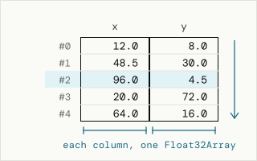</picture>
      <b>Typed-array columns</b><br>
      Components live in columns, grouped by archetype. A system is a loop straight down a <code>Float32Array</code>.
    </td>
    <td width="33%" valign="top">
      <picture><source media="(prefers-color-scheme: dark)" srcset=".github/readme/tile-types-dark.svg">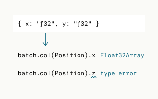</picture>
      <b>Types from one schema</b><br>
      The schema you write types both the storage and your code. A wrong field name doesn't compile.
    </td>
    <td width="33%" valign="top">
      <picture><source media="(prefers-color-scheme: dark)" srcset=".github/readme/tile-reactivity-dark.svg"></picture>
      <b>Reactivity</b><br>
      Watch a query, one value or a resource, with no dirty flags. It stays dormant until the first observer.
    </td>
  </tr>
  <tr>
    <td width="33%" valign="top">
      <picture><source media="(prefers-color-scheme: dark)" srcset=".github/readme/tile-document-dark.svg">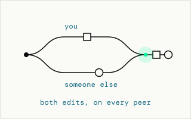</picture>
      <b>A shared document</b><br>
      Stored for good and synced between people. Edits merge without conflicts, and undo is per person.
    </td>
    <td width="33%" valign="top">
      <picture><source media="(prefers-color-scheme: dark)" srcset=".github/readme/tile-presence-dark.svg">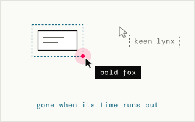</picture>
      <b>Presence</b><br>
      Cursors and selections for everyone in the room. They expire by themselves when someone leaves.
    </td>
    <td width="33%" valign="top">
      <picture><source media="(prefers-color-scheme: dark)" srcset=".github/readme/tile-devtools-dark.svg">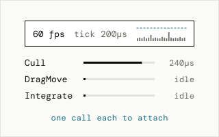</picture>
      <b>Devtools</b><br>
      An inspector panel and a frame profiler with percentiles and a worst-frame capture.
    </td>
  </tr>
</table>

Also: tags, relations that cascade when an entity is destroyed, world resources, save and load for the whole world (`world.export()`, `world.import()`), two React hooks, and a [headless host](examples/headless-host) for Node.

## Multiplayer

<p align="center">
  <a href="https://vibefield.github.io/strata-ecs/demo/?collab=demo">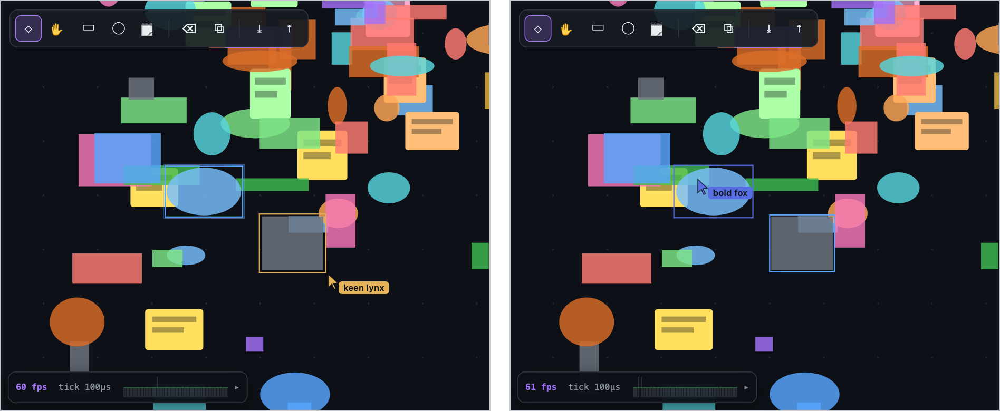</a>
</p>

<p align="center"><sub>Two tabs in one room of the <a href="https://vibefield.github.io/strata-ecs/demo/?collab=demo">demo</a>, with its side panels hidden. Each shows the other's cursor and selection. The names are made up by the demo.</sub></p>

```ts
import { LoroDoc } from "loro-crdt";
import { createDurableStore, attachDurable } from "@vibecook/strata-ecs/durable";

const doc = createDurableStore(new LoroDoc());
attachDurable(world, doc);

doc.subscribeOutbound((bytes) => transport.send(bytes));
transport.onMessage((bytes) => doc.applyRemote(bytes));

doc.transaction((tx) => {
  tx.spawn({ components: [[Position, { x: 0, y: 0 }]] });
});
```

Merging is [Loro](https://loro.dev)'s job, so you write no conflict code and no server has to decide. Anything that carries a `Uint8Array` works as the transport: WebSocket, `BroadcastChannel`, WebRTC. One transaction is one undo step.

`@vibecook/strata-ecs/ephemeral` does the same for presence. The [guide](https://vibefield.github.io/strata-ecs/#collab) covers both layers.

## Benchmarks

<p align="center">
  <picture>
    <source media="(prefers-color-scheme: dark)" srcset=".github/readme/bench-dark.svg">
    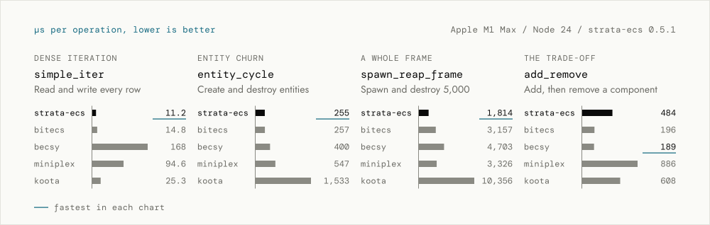
  </picture>
</p>

strata-ecs ties bitecs on dense iteration and leads when entities are created and destroyed. It loses when components are added and removed often, because each change moves the row to another table. [BENCHMARKS.md](BENCHMARKS.md) has all ten scenarios, the losses and the method. The numbers were measured on 0.5.1 in July 2026.

## When not to use it

- **A traditional game.** Adding and removing components every frame, and random reads by handle, are its weak spots. [bitecs](https://github.com/NateTheGreatt/bitECS) fits a game loop better.
- **A few dozen objects.** Below a few hundred entities, React state or plain objects are simpler and fast enough.
- **Server-side business models.** This is a client-side document runtime built around a frame loop.
- **Everything should persist.** Here you choose what goes into the document. If all your state should persist, a document store alone ([Loro](https://loro.dev), Yjs, Automerge) is simpler.

## Entry points

| Import                           | What                                | Needs       |
| -------------------------------- | ----------------------------------- | ----------- |
| `@vibecook/strata-ecs`           | The core ECS and reactivity         | nothing     |
| `@vibecook/strata-ecs/durable`   | The document layer                  | `loro-crdt` |
| `@vibecook/strata-ecs/ephemeral` | The presence layer                  | `loro-crdt` |
| `@vibecook/strata-ecs/react`     | `useComponent` and `useResource`    | `react` 18+ |
| `@vibecook/strata-ecs/tools`     | The observer panel and the profiler | nothing     |

ESM only. Each entry ships a development build with misuse warnings and a production build without them, and Vite and webpack pick the right one.

## Status

- **0.x.** The API can still change between minor versions. Pin your version and read the [changelog](CHANGELOG.md) when you bump it.
- **Built, not planned.** The core, reactivity, both collaboration layers, the devtools and the example app are complete and under test.
- **Node 20 or later** to use it. Developing it needs Node 24.

<details>
<summary><b>Development</b></summary>

<br>

```sh
pnpm install
pnpm run ci           # typecheck, lint, tests and the stress smoke: the merge gate
pnpm bench            # microbenchmarks
pnpm build            # dist/, as ESM with types
pnpm example:canvas   # the whiteboard, live against src/
pnpm collab:server    # a byte relay, for multiplayer across machines
```

The code is in [`src/core`](src/core) (the runtime), [`src/durable`](src/durable) and [`src/ephemeral`](src/ephemeral) (the collaboration layers), and [`src/tools`](src/tools) and [`src/react`](src/react). [`examples/canvas-editor`](examples/canvas-editor) is the demo, and [`docs/`](docs) is the guide's source. See [CONTRIBUTING.md](CONTRIBUTING.md).

</details>

<br>

<p align="center">
  <a href="https://github.com/vibefield">
    <picture>
      <source media="(prefers-color-scheme: dark)" srcset=".github/readme/vibefield-dark.svg">
      
    </picture>
  </a>
</p>

<p align="center">
  <sub><a href="LICENSE">MIT</a> © 2026 James Yong. strata-ecs runs under <a href="https://github.com/vibefield/infinite-canvas-engine">ICE</a>, the canvas engine of <a href="https://github.com/vibefield/vibefield">VibeField</a>.</sub>
</p>
